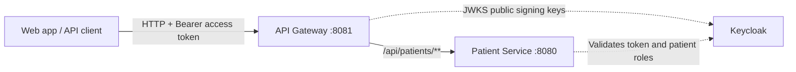

# API Gateway

The API Gateway is the single backend entry point for application API traffic. It exposes the public API route, validates incoming Keycloak access tokens, and forwards requests to the appropriate internal service.

## Where it fits



The current configured route is `/api/patients/**` to Patient Service. The Gateway validates token signature, issuer, expiry, and the `api-gateway-client` audience before forwarding. It preserves the request path and bearer token; Patient Service validates the token independently and enforces `patient-read` or `patient-write` roles. The Gateway is not a user database and does not replace service-level authorization.

## Ports and service addresses

| Run mode | Gateway address / port | Patient Service target | Keycloak signing keys |
| --- | --- | --- | --- |
| Hybrid (Java on host) | `localhost:8081` | `localhost:8080` (`application-local.yml`) | `localhost:8082` |
| Docker Compose | Host `localhost:8081`; container `api-gateway:8081` | `http://patient-service:8080` | `http://keycloak:8080/.../certs` |
| Kubernetes | Cluster Service `api-gateway.hashimoto-core.svc.cluster.local:8081`; ingress exposes `/api` on the platform origin | `http://patient-service.hashimoto-core.svc.cluster.local:8080` | Internal Keycloak Service DNS in `hashimoto-infra` |

In Kubernetes and Compose, backend-to-backend traffic uses service DNS names, not a developer machine's `localhost`. The public token issuer still uses the browser-facing Keycloak URL configured for that mode; issuer and JWKS addresses have different purposes. See [Keycloak architecture](../docs/keycloak.md).

## Run in hybrid development

Requirements: JDK 21 and Maven. Start PostgreSQL, Kafka, and Keycloak in Docker Compose, then start Patient Service and run:

```bash
mvn spring-boot:run -Dspring-boot.run.profiles=local
```

The local profile routes patient requests to `localhost:8080` and retrieves Keycloak keys from `localhost:8082`. From the repository root, the complete hybrid sequence is in the [root README](../README.md#hybrid-development-local-services--docker-infrastructure).

## Current API and operations

- `POST /api/patients` is routed to Patient Service and requires a valid token with the `patient-write` role.
- `GET /api/patients` is routed to Patient Service and requires a valid token with the `patient-read` role.
- `/actuator/health` and `/actuator/prometheus` are exposed for health and metrics collection.
- The Gateway runs as a reactive Spring Cloud Gateway application on port `8081`.

No service-specific routes should be called directly from the browser; add and maintain public API routes here as services are introduced. Platform deployment and K3d steps are in [Kubernetes architecture](../docs/k8s-architecture.md) and [onboarding](../docs/k8s-onboarding.md).
