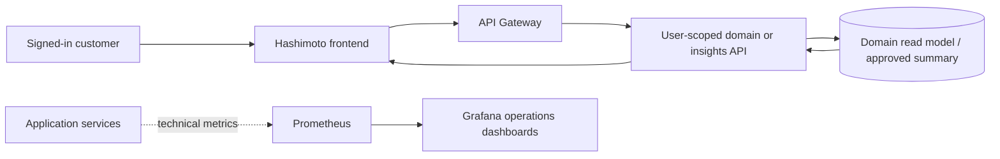
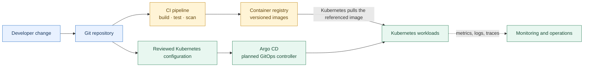

# Hashimoto Platform — Target Architecture

## Executive view

Hashimoto is planned as a digital health platform that brings together a web and mobile experience, identity management, patient-facing services, data from connected health platforms, and a secure event backbone. It will help people record symptoms, medication, routines, food, activity, sleep, and other factors that may relate to how they feel. The current Kubernetes environment is a local development foundation. Several services shown here, along with mobile apps, device integrations, analytics, AI integrations, and GitOps delivery, are future capabilities rather than deployed components.

The architecture separates three kinds of work:

1. **Interactive product requests** travel from the application through the API Gateway to the relevant business service.
2. **Domain events** are published to Kafka so other services and analytics can process changes asynchronously.
3. **Optional AI analysis** is an isolated, policy-controlled consumer of approved data. It calls a provider API from the backend, never directly from the user's browser.

## Platform context

```mermaid
flowchart LR
  classDef client fill:#E8F1FF,stroke:#3478C7,color:#17365D
  classDef edge fill:#F1EAFE,stroke:#7955B3,color:#38245E
  classDef app fill:#E8F7F0,stroke:#33835E,color:#174B35
  classDef data fill:#FFF4D6,stroke:#C38B19,color:#61440B
  classDef identity fill:#FFE8E8,stroke:#C65353,color:#682727
  classDef future fill:#F2F4F7,stroke:#8492A6,color:#344054,stroke-dasharray: 5 5

  subgraph People[People and channels]
    Web[Web application]
    Mobile[Mobile application<br/>planned]
    HealthConnect[Health Connect<br/>Android device data]
    HealthKit[HealthKit<br/>iPhone and Apple Watch data]
  end

  Edge[Local ingress / public edge]
  WebApp[Hashimoto web experience]
  Gateway[API Gateway]
  Identity[Keycloak<br/>sign-in and access tokens]
  Domains[Business services<br/>Patient · Profile · Symptoms · Reports<br/>Medication · Appointments · Activity · Reflection]
  Integrations[Health data integration layer<br/>device sync · provider adapters · OAuth]
  Ingest[Consent checks · validation<br/>normalization · deduplication]
  ProviderAPIs[Provider cloud APIs<br/>when available and approved]
  Kafka[(Kafka event backbone)]
  Data[(Service-owned data stores<br/>logical separation by domain)]
  Analytics[Analytics and insight services<br/>planned]
  AI[AI integration service<br/>planned, optional]
  Insights[(Analytics insight store<br/>planned)]
  Provider[External model provider API<br/>provider to be selected]
  Observe[Metrics, logs, and traces]

  Web --> Edge
  Mobile -.-> Edge
  Mobile -->|user-authorized read| HealthConnect
  Mobile -->|user-authorized read| HealthKit
  Edge --> WebApp
  Edge --> Gateway
  WebApp -. OIDC sign-in .-> Identity
  Gateway --> Domains
  Gateway --> Integrations
  HealthConnect -->|selected data sync| Integrations
  HealthKit -->|selected data sync| Integrations
  Integrations <-->|OAuth, sync, or webhooks<br/>provider-dependent| ProviderAPIs
  Integrations --> Ingest
  Ingest --> Data
  Ingest --> Kafka
  Domains --> Data
  Domains --> Kafka
  Kafka --> Analytics
  Analytics --> AI
  AI --> Provider
  AI --> Insights
  Gateway --> Analytics
  Domains -. telemetry .-> Observe
  Gateway -. telemetry .-> Observe
  Analytics -. telemetry .-> Observe

  class Web,Mobile,HealthConnect,HealthKit client
  class Edge edge
  class WebApp,Gateway,Domains app
  class Kafka,Data data
  class Identity identity
  class Integrations,Ingest,Analytics,AI,Insights,ProviderAPIs future
  class Observe data
```

The diagram shows the intended product direction, not a claim that every box is running today. The next section separates what exists from what is planned.

## Current foundation and planned capabilities

| Capability | Current local Kubernetes foundation | Target direction |
| --- | --- | --- |
| User experience | React/Vite frontend served in the cluster | Web and, later, mobile applications |
| Edge and API access | Traefik Ingress and API Gateway | Stable external entry point, routing, throttling, and API policy |
| Identity | Keycloak with OIDC; roles protect patient operations | Central identity lifecycle and role/group administration |
| Business domain | Patient Service | Add services only as domain boundaries and ownership become clear |
| Planned service areas | Not deployed as separate services | Profile, symptoms, reports, medication, appointments, activity, and daily reflection |
| Connected health data | No Health Connect, HealthKit, or wearable-provider connectors are deployed | Mobile OS health stores plus selected provider cloud APIs through one integration layer |
| Persistence and events | PostgreSQL and Kafka are deployed for development | Domain-owned data stores and versioned events with clear ownership |
| Observability | Prometheus/Grafana starter operations dashboard plus Filebeat/Elasticsearch/Kibana log search | Add service-level dashboards, tracing, alerting, and operational ownership |
| Analytics and AI | Not deployed | Event-driven analytics and an optional provider-neutral AI integration |
| Delivery automation | Local Makefile and K3d deployment | CI builds/tests/scans images; Argo CD reconciles approved Kubernetes manifests |

The platform currently has a shared PostgreSQL server with separate `patient_db` and `keycloak_db` databases. The target “service-owned data” model is a design direction: each service should own its data contract and other services should not query its tables directly. It does not require running a separate PostgreSQL server for every service on day one.

Keycloak is the identity provider. It handles authentication and issues tokens; it is not the application profile database. A future Profile Service should own product-specific profile data without duplicating passwords or identity credentials.

## Business domains

These are candidate service boundaries for the product roadmap. They should be introduced when each area has a clear responsibility, data owner, API/event contract, and independent reason to deploy or scale.

| Domain | Example responsibility |
| --- | --- |
| Patient | Patient records and patient-facing workflows |
| Profile | Preferences and product-specific profile information; identity remains in Keycloak |
| Symptoms | Symptom observations and history |
| Reports | Generated or submitted health reports and their lifecycle |
| Medication | Medication plans, reminders, and adherence information |
| Appointments | Appointment scheduling and status |
| Activity | Activity records and related summaries |
| Daily Reflection | Daily check-ins and reflection entries |

This list is a target map, not an instruction to create eight microservices immediately. Starting with a smaller set of well-bounded services keeps local development and operations manageable.

## Customer-facing charts and operational dashboards

Keep product visualizations separate from platform monitoring:

| Need | Data and tools | Audience |
| --- | --- | --- |
| Is the API up? How many requests arrive? Is a service using too much memory? | Prometheus scrapes technical metrics; Grafana presents operational dashboards | Developers and operators |
| How did this person's symptoms or routines change over time? | Domain records or an authorized, user-scoped analytics/read API; the Hashimoto frontend renders the result | The signed-in customer and, where explicitly authorized, their coach |

Prometheus labels and Grafana dashboards must not contain personal health records or become the customer reporting API. The first customer charts can be simple descriptions of that user's saved entries—such as counts or a trend by day—returned by the owning domain service. Add a separate analytics projection/service only when product needs or query load justify it.

Before returning a chart, enforce ownership/role checks in the backend and retain the time range, units, source, and missing-data context needed to interpret it. If analytics combines multiple sources, preserve provenance and consent boundaries. Present correlations as observations, not proof of cause or medical advice. The planned event-driven insight flow is described in [Future real-time analytics and AI flow](#future-real-time-analytics-and-ai-flow); the first user-visible personal summaries are a later product milestone, not a current feature.

## Connected health platforms and data ingestion

Place integrations between the user's device/provider and Hashimoto's health-data ingestion boundary. Treat each source as an adapter behind a stable internal contract; symptom, routine, medication, and analytics features should consume Hashimoto's normalized records instead of depending directly on HealthKit, Health Connect, or a vendor-specific API.

### Mobile health stores

- **Android:** the mobile app requests granular permission for selected data types and reads them from Health Connect on the user's device. Health Connect is a device-side health data store; it is not a Kubernetes-accessible cloud endpoint. The app sends only the approved records to Hashimoto's authenticated ingestion API. Android documentation describes Health Connect as on-device data under user control and positions it for mobile-first apps ([Health Connect overview and Google Fit migration guidance](https://developer.android.com/health-and-fitness/guides/health-connect/migrate/fit-apis-end-of-service)).
- **iOS:** the iPhone app requests per-type HealthKit permission and reads approved samples from the HealthKit store. HealthKit permissions can change, and the app must handle missing or limited history without assuming that it has access to a complete record ([Apple HealthKit authorization documentation](https://developer.apple.com/documentation/healthkit/authorizing-access-to-health-data)).

The current web client cannot replace these native permission APIs. If mobile is a later milestone, keep the backend ingestion contract independent of the eventual mobile framework, but plan for native Android/iOS integration work.

### Cloud provider APIs

For services that expose a server API, use a backend provider connector. The user authorizes the provider through its OAuth consent flow; the connector stores refresh credentials encrypted and retrieves or receives data according to that provider's supported sync model. Keep third-party OAuth credentials separate from Keycloak app tokens. Never put provider client secrets or long-lived refresh tokens in browser storage.

Do not start a new integration against the legacy Google Fit APIs: Google says they will stop being available at the end of 2026. Health Connect is the recommended Android path for mobile-first access. Google's newer Google Health API is the cloud-oriented path, but its current developer page says it is not onboarding new projects yet; treat it as an option only after access is confirmed. Fitbit's legacy Web API is also scheduled to be turned off on October 30, 2026 ([Google Fit migration guidance](https://developer.android.com/health-and-fitness/guides/health-connect/migrate/fit-apis-end-of-service), [Google Health API availability and migration](https://developers.google.com/health/get-started)).

### Normalize, preserve provenance, and make sync repeatable

At ingestion, validate permissions and schema, convert units and timestamps, and map source records to a small Hashimoto canonical model. Preserve enough provenance to explain each value: source/provider, source record ID, sample type, original unit/value, normalized value/unit, observed time with timezone, ingestion time, device/source application, and whether a person entered or edited it. Use source IDs and sync cursors to make retries idempotent and prevent duplicate samples. Do not silently replace a person's manual symptom or food entry with an imported value.

Model permissions and connection state explicitly: data types granted, grant/revocation times, last successful sync, checkpoint/cursor, and user-triggered disconnect. Provide a way to pause syncing, revoke a provider connection, and request deletion according to the product's retention policy. A revoked permission or unavailable provider should stop new ingestion without deleting unrelated Hashimoto records.

Health Connect/HealthKit syncing is not a promise of continuous real-time delivery. Devices may be offline, background work may be delayed, scopes may be removed, and vendor APIs may rate-limit. Keep the user-entered symptom and routine flows available when an integration is disconnected; show the source and last sync time for imported data.

## Future real-time analytics and AI flow

“Real time” should mean that new events can be processed shortly after they occur; it does not require blocking a user's save request while an external AI provider responds. Keep the user-facing write path fast and use Kafka to drive analysis asynchronously.

```mermaid
flowchart LR
  classDef source fill:#E8F7F0,stroke:#33835E,color:#174B35
  classDef control fill:#FFF4D6,stroke:#C38B19,color:#61440B
  classDef ai fill:#F1EAFE,stroke:#7955B3,color:#38245E
  classDef external fill:#E8F1FF,stroke:#3478C7,color:#17365D

  User[User submits or updates data] --> API[API Gateway and domain service]
  API --> Store[(Domain data store)]
  API --> Event[Publish domain event]
  Event --> Kafka[(Kafka)]
  Kafka --> Consumer[Analytics consumer]
  Consumer --> Gate[Consent, purpose, and data-minimization checks]
  Gate --> Safe[Approved and minimized analysis payload]
  Safe --> AI[AI orchestration / provider adapter]
  AI -->|HTTPS API call| Provider[Selected external AI provider]
  Provider --> AI
  AI --> Review[Validate, label, and audit result]
  Review --> Insights[(Insight store)]
  Insights --> ReadAPI[Insights API]
  ReadAPI --> Gateway
  Gateway --> UI[Show permitted result in the application]

  class User,API,Store source
  class Event,Kafka,Consumer control
  class Gate,Safe,Review,Insights control
  class AI,ReadAPI ai
  class Provider external
  class UI source
```

The analytics flow should consume both user-entered domain events (symptoms, medication, meals, and routines) and imported activity/sleep records from the integration layer. Keep source attribution and time zones through aggregation so a pattern can be traced back to the data that contributed to it. Start with transparent summaries and statistical methods; introduce a model only where it adds measurable value.

The AI integration service is a boundary between Hashimoto and any external provider. It centralizes provider credentials, request limits, timeouts, retries, model selection, audit records, and data filtering. Domain services and browsers should not call model-provider APIs directly.

Before sending any health or personal data to an external provider, define the permitted purpose and consent, minimize or pseudonymize the payload where possible, enforce tenant/user access, encrypt traffic, control retention, and record the decision and outcome. Health data is a specially protected category under [GDPR Article 9](https://eur-lex.europa.eu/eli/reg/2016/679/oj); device-level permission to share data does not by itself resolve the platform's legal basis and privacy obligations. Review those with qualified privacy and legal professionals before launch. Do not send identifiable customer data until privacy, security, clinical-safety, and provider-contract requirements have been reviewed.

Present discovered relationships as possible associations with their time window, data sources, uncertainty, and missing-data caveats. Do not state that correlation proves a cause, and do not have the app recommend starting, stopping, or changing medication. AI-generated output should be an assistive insight, not an unreviewed diagnosis or clinical decision.

Choose the runtime interface for the intended job. For direct model inference, use a server-side model API such as the [OpenAI API](https://developers.openai.com/api/docs/quickstart) or another provider. For agent workflows, OpenAI also documents options such as the [Agents SDK and Agents API](https://developers.openai.com/api/docs/guides/agents/sdk); evaluate their exact capabilities and data controls before selecting one. Codex is positioned as an AI coding agent and has developer integrations, so do not assume a ChatGPT/Codex end-user subscription is the same as a production inference integration. OpenAI documents that ChatGPT and API Platform billing are [managed separately](https://help.openai.com/en/articles/9039756-managing-billing-for-chatgpt-and-the-api-platform). Keep the provider behind the adapter so the platform can change vendors.

## Security and trust boundaries

- The browser authenticates with Keycloak using OIDC and sends an access token to the API Gateway.
- The Gateway and each protected service validate tokens and enforce their own authorization rules. The frontend hiding a control is not an authorization boundary.
- Service-to-service calls and Kafka events use explicit identities and permissions as the platform grows; network location alone is not authorization.
- External AI calls leave the platform's trust boundary. Apply data minimization, consent/purpose checks, secrets management, egress restrictions, timeouts, audit, and retention controls before enabling them.
- Keep development credentials and local K3d settings out of shared or production environments.

## Delivery and operations roadmap

The intended GitOps delivery path is separate from customer request and data flows:

CI should produce immutable, versioned images and report build/test/security results. Argo CD should reconcile reviewed deployment configuration from Git. The current project uses local Makefile targets and K3d; the CI/CD and Argo CD components in this diagram are planned and are not part of the current cluster.

## Current implementation references

- Current Kubernetes resources: [`k8s/`](../k8s/)
- Current deployment architecture: [Kubernetes architecture](k8s-architecture.md)
- Cluster setup and commands: [K3d onboarding](k8s-onboarding.md)
- Identity, tokens, and the three runtime modes: [Keycloak architecture and configuration](keycloak.md)

This document describes a target architecture. Update the capability table as roadmap items move into the deployed platform, and review each external-data flow before enabling it with real customer data.
