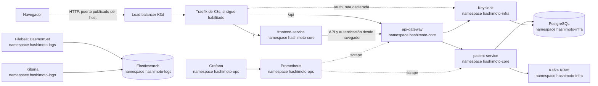

# Arquitectura Kubernetes de Hashimoto Platform

## Alcance

Este documento describe lo que los manifiestos de `k8s/` definen hoy. Es una instalación de desarrollo local sobre K3d/K3s, no una arquitectura de producción: usa credenciales de ejemplo, réplicas únicas, almacenamiento `local-path` y varios servicios sin endurecimiento de seguridad.

Los diagramas anteriores en `docs/Architecture.md` y `docs/HashimotoArchitecureKubernetes.md` incluyen componentes futuros (varios microservicios, Argo CD, móviles, etc.). No forman parte del despliegue Kubernetes actual.

## Vista general

La presencia de una flecha representa intención/configuración; los probes de disponibilidad y las comprobaciones del onboarding verifican que los servicios estén listos.

## Namespaces y responsabilidades

| Namespace | Responsabilidad | Recursos principales |
| --- | --- | --- |
| `hashimoto-core` | Cargas de negocio y configuración de aplicación | Frontend, API Gateway, Patient Service, Ingress |
| `hashimoto-infra` | Persistencia, mensajería e identidad | PostgreSQL, Kafka, Keycloak |
| `hashimoto-ops` | Métricas | Prometheus y Grafana |
| `hashimoto-logs` | Recolección y búsqueda de registros | Filebeat, Elasticsearch y Kibana |

Los namespaces aíslan nombres y políticas de recursos; no crean por sí solos una barrera de red. Las comunicaciones internas usan Services DNS, por ejemplo `postgres-service.hashimoto-infra.svc.cluster.local:5432`.

PostgreSQL es una instancia compartida en desarrollo, con una base por servicio: `patient_db` para Patient Service (incluidos Axon y su proyección) y `keycloak_db` para Keycloak. Los nombres se mantienen iguales en Compose, ejecución local y Kubernetes. Ambos usan hoy el usuario PostgreSQL de desarrollo común; separar credenciales/permisos es una mejora posterior.

### Identidad y validación de tokens

Keycloak publica un issuer fijo por escenario; Spring valida la firma usando una URL JWKS alcanzable desde la red de cada backend y comprueba explícitamente el claim `iss`. En Compose el issuer público es `http://localhost:8082/realms/hashimoto-realm`, aunque los contenedores descargan las claves desde `keycloak:8080`. En Kubernetes el navegador usa `http://hashimoto.local:8085/auth`, mientras los pods usan el DNS interno de `keycloak-service` para descargar las claves. En el modo híbrido, los procesos locales usan `localhost:8082` para ambos valores.

Patient Service aplica autorización por rol de realm: `patient-read` permite `GET /api/patients` y `patient-write` permite `POST /api/patients`. Los roles se asignan a grupos/usuarios en Keycloak y llegan en `realm_access.roles`; el conversor los mapea a autoridades de Spring.

El hostname de Keycloak no se infiere de cualquier cabecera entrante: la imagen fijada es Keycloak 24 y Compose/Kubernetes fijan `KC_HOSTNAME_URL`; Kubernetes además sirve su contexto bajo `/auth` y confía en `X-Forwarded-*` del Ingress. El cliente `hashimoto-tracker-web` permite solo los orígenes locales explícitos configurados para Vite/Compose y Kubernetes; no usa origen comodín. Al actualizar Keycloak, revisa la migración de configuración de hostname correspondiente a la nueva versión.

## Componentes

- **K3d/K3s:** K3d ejecuta nodos K3s como contenedores Docker. Rancher creó K3s; eso no implica que Rancher Manager esté instalado. K3s instala Traefik por defecto salvo que se desactive al crear el clúster.
- **Entrada:** los Ingress declaran `/` al frontend, `/api` al gateway y `/auth` a Keycloak. El manifiesto declara `ingressClassName: traefik`. El controlador real debe coincidir con esa clase.
- **Aplicación:** los tres servicios de aplicación son Deployments con una réplica e imágenes locales `hashimoto/*:latest`, importadas al clúster por el Makefile.
- **PostgreSQL:** StatefulSet de una réplica con PVC `local-path` de 10 GiB. El script SQL se monta para inicialización.
- **Kafka:** StatefulSet de una réplica en modo KRaft y PVC de 10 GiB. Una réplica es adecuada para desarrollo, no tolera la pérdida del nodo como un clúster de producción.
- **Keycloak:** Deployment de una réplica que importa el realm desde ConfigMap y usa PostgreSQL.

El realm tiene una sola fuente JSON compartida con Compose; Kustomize genera el ConfigMap de Kubernetes desde ese archivo. Consulta [Keycloak en los tres escenarios](keycloak.md) para el detalle de issuer, JWKS, rutas y proceso de importación.
- **Métricas:** Prometheus descubre los puertos de métricas de los pods Spring en `hashimoto-core`; Grafana viene preconfigurado con Prometheus como datasource. No se incluyen dashboards de aplicación.
- **Registros:** Filebeat corre como DaemonSet y lee los logs del nodo; Elasticsearch almacena e indexa y Kibana consulta. Los directorios de logs montados por las aplicaciones son `emptyDir`, pero Filebeat recolecta logs de contenedores desde los nodos.

## Persistencia y límites

PostgreSQL, Kafka, Prometheus, Grafana y Elasticsearch declaran PVC. La clase `local-path` de K3s crea almacenamiento local asociado al clúster/nodo. No equivale a respaldo: eliminar el clúster puede eliminar los datos. Haz copias de seguridad fuera del clúster si necesitas conservarlos.

### Conexión de Kafka entre namespaces

Patient Service usa `kafka-service.hashimoto-infra.svc.cluster.local:9092` como bootstrap para Spring Kafka y Axon. El bootstrap solo inicia la conexión: después Kafka entrega al cliente las direcciones de broker configuradas en `KAFKA_ADVERTISED_LISTENERS`. Por eso el listener interno anuncia el DNS completo de `kafka-service` en `hashimoto-infra`, que puede resolverse desde `hashimoto-core`; no se debe anunciar `kafka-service:9092`, que depende del namespace de origen del cliente. Compose conserva sus listeners propios (`kafka:29092` para contenedores y `localhost:9092` para procesos en el host).

El quórum KRaft de este despliegue tiene un solo nodo y usa `localhost:29093` para la comunicación del controlador dentro del propio pod. Esto evita que el arranque dependa de resolver un Service de Kubernetes que aún no publica el pod porque todavía no está listo. Para un clúster Kafka multinodo, los voters deben configurarse con DNS estable por pod y un Service headless; esta configuración local de un solo nodo no se debe copiar tal cual a producción.

El modo de desarrollo usa `start-dev` en Keycloak, imágenes `latest` para servicios propios, contraseñas en texto claro en manifiestos, Elastic sin seguridad y recursos limitados/no uniformes. No expongas este clúster a una red pública ni reutilices estas credenciales.

## Límites del entorno local

La pila completa incluye PostgreSQL, Kafka, Elasticsearch, Prometheus, Grafana, Kibana y los servicios de aplicación; ajusta los recursos del equipo si los pods quedan `Pending` u `OOMKilled`. `local-path` guarda los datos dentro de los nodos K3d: eliminar el clúster puede eliminar bases de datos, tópicos, métricas y logs. El entorno usa contraseñas de desarrollo, `start-dev` en Keycloak y una réplica por componente; no debe exponerse a una red pública ni usarse como despliegue productivo.
