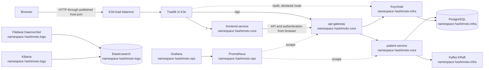

# Hashimoto Platform Kubernetes architecture

## Scope

This document describes the current resources under `k8s/`. They define a local development deployment on K3d/K3s, not a production architecture: the platform uses development credentials, single replicas, `local-path` storage, and several components without production hardening.

Older diagrams in `docs/Architecture.md` and `docs/HashimotoArchitecureKubernetes.md` include future components such as additional microservices, Argo CD, and mobile applications. They are not part of the current Kubernetes deployment.

## Overview

Arrows show configured intent. Readiness probes and the onboarding checks verify that services are ready.

## Namespaces and responsibilities

| Namespace | Responsibility | Main resources |
| --- | --- | --- |
| `hashimoto-core` | Business workloads and application configuration | Frontend, API Gateway, Patient Service, Ingress |
| `hashimoto-infra` | Persistence, messaging, and identity | PostgreSQL, Kafka, Keycloak |
| `hashimoto-ops` | Metrics | Prometheus and Grafana |
| `hashimoto-logs` | Log collection and search | Filebeat, Elasticsearch, and Kibana |

Namespaces separate resource names and policies; they do not create a network security boundary on their own. Internal communication uses Kubernetes Service DNS, for example `postgres-service.hashimoto-infra.svc.cluster.local:5432`.

PostgreSQL is a shared development instance with one database per service: `patient_db` for Patient Service (including Axon and its read projection) and `keycloak_db` for Keycloak. The database names are consistent across Compose, local processes, and Kubernetes. Both databases currently use the shared development PostgreSQL account; separate credentials and grants are a later improvement.

## Identity and token validation

Keycloak publishes a fixed issuer for each runtime mode. Spring validates the token signature using a JWKS URL reachable from each backend's network and explicitly checks the `iss` claim. In Compose, the public issuer is `http://localhost:8082/realms/hashimoto-realm`, while containers fetch signing keys from `keycloak:8080`. In Kubernetes, the browser-facing issuer is `http://localhost:8085/auth/realms/hashimoto-realm`, while pods retrieve signing keys through the internal `keycloak-service` DNS name. In hybrid mode, Java processes on the host use `localhost:8082` for both issuer and JWKS.

Patient Service authorizes operations using realm roles: `patient-read` permits `GET /api/patients`, and `patient-write` permits `POST /api/patients`. Roles are assigned to groups or users in Keycloak and appear in `realm_access.roles`; the Spring converter maps them to Spring authorities.

The Keycloak hostname is not inferred from arbitrary incoming headers. The image is pinned to Keycloak 24, and Compose/Kubernetes set `KC_HOSTNAME_URL`. Kubernetes also serves Keycloak under `/auth` and trusts the Ingress `X-Forwarded-*` headers. The `hashimoto-tracker-web` client allows only the explicit local origins configured for Vite/Compose and Kubernetes; it does not use a wildcard origin. Review the hostname configuration migration when upgrading Keycloak.

See [Keycloak architecture and configuration](keycloak.md) for the detailed comparison of Kubernetes, Compose, and hybrid runtime URLs, clients, realm import, and user management.

## Components

- **K3d/K3s:** K3d runs K3s nodes as Docker containers. K3s includes Traefik by default unless it is disabled when the cluster is created. A previous Rancher-created K3s cluster does not imply that Rancher Manager is installed.
- **Ingress:** Ingress resources route `/` to the frontend, `/api` to the Gateway, and `/auth` to Keycloak. They declare `ingressClassName: traefik`; the active controller must match this class.
- **Application:** The three application services are single-replica Deployments using commit-tagged `hashimoto/*` images, built and imported into K3d by the Makefile. `k8s/core/kustomization.yaml` is the declarative source for the image tags and core resources.
- **PostgreSQL:** A single-replica StatefulSet with a 10 GiB `local-path` PVC. An SQL initialization script is mounted into the container.
- **Kafka:** A single-replica KRaft StatefulSet with a 10 GiB PVC. One replica is suitable for development but does not tolerate node loss like a production cluster.
- **Keycloak:** A single-replica Deployment that imports the realm from a ConfigMap and uses PostgreSQL.
- **Metrics:** Prometheus discovers the Spring pod metrics endpoints in `hashimoto-core`. Grafana is preconfigured to use Prometheus and loads the Hashimoto Platform Overview operations dashboard. Customer health charts are future application features, separate from operational monitoring.
- **Logs:** Filebeat runs as a DaemonSet and reads node container logs. Elasticsearch stores and indexes them, and Kibana queries them. Application log directories are `emptyDir`, while Filebeat collects container logs from the nodes.

The realm has one JSON source shared with Compose; Kustomize builds the Kubernetes ConfigMap from that file.

## Persistence and operational limits

PostgreSQL, Kafka, Prometheus, Grafana, and Elasticsearch declare PVCs. K3s `local-path` storage is attached to the local cluster/node; it is not a backup. Deleting the cluster may delete this data. Keep backups outside the cluster if the data matters.

### Kafka across namespaces

Patient Service uses `kafka-service.hashimoto-infra.svc.cluster.local:9092` as the bootstrap address for Spring Kafka and Axon. Bootstrap only establishes the first connection. Kafka then returns broker addresses configured in `KAFKA_ADVERTISED_LISTENERS`. The internal listener therefore advertises the full DNS name of `kafka-service` in `hashimoto-infra`, which resolves from `hashimoto-core`. Do not advertise `kafka-service:9092`, which depends on the client's source namespace. Compose has its own listeners: `kafka:29092` for containers and `localhost:9092` for host processes.

This deployment's single-node KRaft quorum uses `localhost:29093` for controller communication inside its own pod. This avoids making startup depend on a Kubernetes Service that cannot publish the pod before it is ready. For a multi-node Kafka cluster, configure voters with stable per-pod DNS and a headless Service; do not copy this single-node local setup unchanged into production.

## Local hostname and entry point

K3d publishes host ports `8085 → 80` and `8443 → 443` on its load balancer. The frontend Ingress accepts requests for `localhost` and `hashimoto.local`; the Keycloak Ingress and Keycloak realm issuer are currently configured for `localhost`. Add a local host mapping for `hashimoto.local` if you need the alias to resolve, but use `http://localhost:8085/` as the supported browser entry point for sign-in and registration. The browser treats `localhost` as a secure context required for Web Crypto and OIDC PKCE; plain HTTP on `hashimoto.local` is not guaranteed to provide that API and the current Keycloak hostname/redirect configuration does not use that alias.

The onboarding guide shows how to add and verify the local host mapping. Supporting `hashimoto.local` as the full OIDC browser origin requires a separate HTTPS and Keycloak hostname/redirect configuration change.

## Security and environment limits

The development deployment uses Keycloak `start-dev`, local-only application images, plaintext development passwords in manifests, Elasticsearch without security, and limited/non-uniform resources. Do not expose this cluster to a public network or reuse these credentials. Argo CD can reconcile the Kustomize manifests once the matching image tags have been built and imported into K3d; it does not build or distribute the images.

The full stack includes PostgreSQL, Kafka, Elasticsearch, Prometheus, Grafana, Kibana, and the application services. Adjust host resources if pods remain `Pending` or are `OOMKilled`. `local-path` stores data inside K3d nodes; deleting the cluster may remove databases, topics, metrics, and logs. This is a local learning environment with development passwords and one replica per component, not a production deployment.
