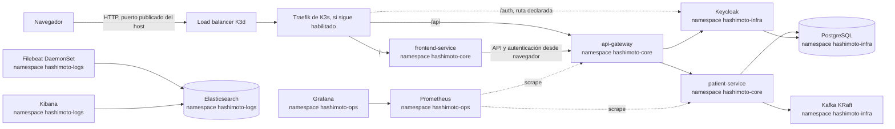

# Arquitectura Kubernetes de Hashimoto Platform

## Alcance

Este documento describe lo que los manifiestos de `k8s/` definen hoy. Es una instalación de desarrollo local sobre K3d/K3s, no una arquitectura de producción: usa credenciales de ejemplo, réplicas únicas, almacenamiento `local-path` y varios servicios sin endurecimiento de seguridad.

Los diagramas anteriores en `docs/Architecture.md` y `docs/HashimotoArchitecureKubernetes.md` incluyen componentes futuros (varios microservicios, Argo CD, móviles, etc.). No forman parte del despliegue Kubernetes actual.

## Vista general

La presencia de una flecha representa intención/configuración, no una garantía de que la conexión funcione. Hay discrepancias actuales detalladas en [Observaciones para un despliegue reproducible](#observaciones-para-un-despliegue-reproducible).

## Namespaces y responsabilidades

| Namespace | Responsabilidad | Recursos principales |
| --- | --- | --- |
| `hashimoto-core` | Cargas de negocio y configuración de aplicación | Frontend, API Gateway, Patient Service, Ingress |
| `hashimoto-infra` | Persistencia, mensajería e identidad | PostgreSQL, Kafka, Keycloak |
| `hashimoto-ops` | Métricas | Prometheus y Grafana |
| `hashimoto-logs` | Recolección y búsqueda de registros | Filebeat, Elasticsearch y Kibana |

Los namespaces aíslan nombres y políticas de recursos; no crean por sí solos una barrera de red. Las comunicaciones internas usan Services DNS, por ejemplo `postgres-service.hashimoto-infra.svc.cluster.local:5432`.

## Componentes

- **K3d/K3s:** K3d ejecuta nodos K3s como contenedores Docker. Rancher creó K3s; eso no implica que Rancher Manager esté instalado. K3s instala Traefik por defecto salvo que se desactive al crear el clúster.
- **Entrada:** los Ingress declaran `/` al frontend, `/api` al gateway y `/auth` a Keycloak. El manifiesto declara `ingressClassName: traefik`. El controlador real debe coincidir con esa clase.
- **Aplicación:** los tres servicios de aplicación son Deployments con una réplica e imágenes locales `hashimoto/*:latest`, importadas al clúster por el Makefile.
- **PostgreSQL:** StatefulSet de una réplica con PVC `local-path` de 10 GiB. El script SQL se monta para inicialización.
- **Kafka:** StatefulSet de una réplica en modo KRaft y PVC de 10 GiB. Una réplica es adecuada para desarrollo, no tolera la pérdida del nodo como un clúster de producción.
- **Keycloak:** Deployment de una réplica que importa el realm desde ConfigMap y usa PostgreSQL.
- **Métricas:** Prometheus descubre pods en `hashimoto-core`; Grafana consulta Prometheus. Los manifiestos no declaran datasource ni dashboards de Grafana.
- **Registros:** Filebeat corre como DaemonSet y lee los logs del nodo; Elasticsearch almacena e indexa y Kibana consulta. Los directorios de logs montados por las aplicaciones son `emptyDir`, pero Filebeat recolecta logs de contenedores desde los nodos.

## Persistencia y límites

PostgreSQL, Kafka, Prometheus, Grafana y Elasticsearch declaran PVC. La clase `local-path` de K3s crea almacenamiento local asociado al clúster/nodo. No equivale a respaldo: eliminar el clúster puede eliminar los datos. Haz copias de seguridad fuera del clúster si necesitas conservarlos.

El modo de desarrollo usa `start-dev` en Keycloak, imágenes `latest` para servicios propios, contraseñas en texto claro en manifiestos, Elastic sin seguridad y recursos limitados/no uniformes. No expongas este clúster a una red pública ni reutilices estas credenciales.

## Observaciones para un despliegue reproducible

Antes de usarlo como procedimiento de instalación, hay que resolver o verificar en los manifiestos los siguientes puntos:

1. **Variables de infraestructura:** `make deploy-infra` no aplica `k8s/infra/platform-env.yaml`, pero PostgreSQL y Keycloak referencian los ConfigMaps/Secrets que define. Aplicarlo antes de desplegar infraestructura.
2. **Base de datos de Keycloak:** el SQL crea `keycloak_db`, mientras `KC_DB_URL` en Keycloak apunta a `hashimoto_db`. Elegir una base y hacer coincidir creación y URL.
3. **Ingress:** el README raíz habla de desactivar Traefik e instalar Nginx con un archivo remoto incompleto/no versionado; los Ingress de `k8s/` declaran `traefik`. Elegir un controlador, documentar la instalación exacta y alinear clase/anotaciones.
4. **Backend de `/auth`:** el backend del Ingress apunta a un nombre DNS FQDN como si fuera un Service del mismo namespace. Existe `keycloak-bridge-service`, pero el Ingress no lo usa. La ruta debe apuntar a un Service válido dentro de `hashimoto-core` o definirse con un diseño de Ingress compatible.
5. **Salida de Filebeat:** `output.elasticsearch.hosts` está configurado como `http://cluster.local`; el Service declarado es `elasticsearch-service` en `hashimoto-logs`, normalmente accesible como `http://elasticsearch-service.hashimoto-logs.svc.cluster.local:9200`.
6. **Configuración de Prometheus:** `prometheus.yaml` monta el ConfigMap `prometheus-config`, pero `make deploy-ops` aplica `k8s/monitoring/` como directorio; kubectl aplica los YAML del directorio, aunque debe comprobarse que primero se crea el ConfigMap y que el RBAC permite la autodetección esperada. La configuración actual solo filtra por namespace y no muestra relabeling del puerto de métricas.
7. **Receta del clúster y puertos:** los documentos contienen recetas distintas. `8085:80` y `8443:443` requieren abrir `http://localhost:8085`; `80:80` publica el puerto 80. La receta debe corresponder a la que se elija.

No se asume que Rancher Manager, Argo CD, Nginx Ingress, cert-manager ni otros operadores estén instalados; no hay manifiestos versionados para ellos en `k8s/`.
