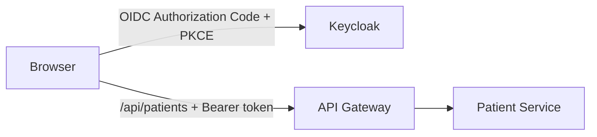

# Hashimoto Tracker Web

The browser application for Hashimoto Platform. It currently provides the sign-in and registration entry points and the patient registration flow. Symptom, medication, routine, and activity tracking are future product work; see the [platform roadmap](../RoadMap.md).

## Where it fits



The app is a React 19, TypeScript, and Vite single-page application. It authenticates through the public Keycloak client `hashimoto-tracker-web`; it does not contain a client secret. API requests use the relative `/api` path, so the browser has one application origin and does not need to know individual service addresses. The API Gateway validates the access token and routes the request; Patient Service validates it again and applies operation-level roles.

## Ports and network paths

| Run mode | Browser URL | App server port | API path from browser |
| --- | --- | --- | --- |
| Vite development / hybrid | `http://localhost:5173` | `5173` | Vite proxies `/api` to `localhost:8081` and `/auth` to Keycloak at `localhost:8082` |
| Docker Compose | `http://localhost:5173` | Container `80`, host `5173` | Nginx proxies `/api` to `api-gateway:8081` and `/auth` to Keycloak on the Compose network |
| K3d / Kubernetes | `http://localhost:8085` | Service `80` behind Traefik | Ingress routes `/api` to the Gateway and `/auth` to Keycloak |

The Compose host port `5173` differs from the container port `80`. In Kubernetes, use the documented browser entry point `localhost:8085`; this origin supports the Web Crypto API required by the OIDC PKCE flow. See the [Kubernetes onboarding guide](../docs/k8s-onboarding.md).

## Run the frontend locally

Requirements: Node.js `20.19+` or `22.12+` and npm. Start the infrastructure and backend services first; the default Vite proxy expects Keycloak on host port `8082` and API Gateway on `8081`.

```bash
npm ci
npm run dev -- --host
```

Open `http://localhost:5173`. For a production build and local static preview:

```bash
npm run build
npm run preview
```

Other package scripts: `npm run lint` runs ESLint. Docker Compose and Kubernetes workflows are documented in the [root README](../README.md).

## Current API integration

`src/services/patient/patientService.ts` sends `POST /api/patients` with a Keycloak bearer token. The current request fields are `firstName`, `lastName`, `gender`, `dni`, `email`, and `age`. The backend requires the `patient-write` role. The app also obtains its user access token through the Keycloak adapter; user passwords are handled by Keycloak and are not sent to this API.

Keycloak realm, client, proxy, and role setup is described in [Keycloak architecture](../docs/keycloak.md) and the [user and role workflow](../docs/keycloak-user-workflow.md).
