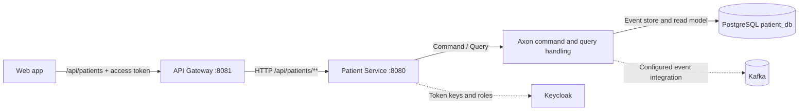

# Patient Service

Patient Service owns the current patient create/read API and its patient data. It is an early foundation for the platform, not yet the symptom, medication, routine, or activity-tracking domain. Those workflows remain roadmap items.

## Where it fits



The HTTP controller translates a create request into an Axon command. The patient aggregate validates the command and emits `PatientCreatedEvent`; the event handler maintains a JPA read model used by the query handler. Axon event storage and the patient read model use PostgreSQL. Kafka and the Axon Kafka extension are configured with the `patient-events` default topic for event integration. Consumers and downstream business workflows are future work; this README does not imply that other services already consume those events.

## Ports and dependencies

| Run mode | HTTP port | PostgreSQL | Kafka | Keycloak JWKS |
| --- | --- | --- | --- | --- |
| Hybrid (Java on host) | `localhost:8080` | `localhost:5432/patient_db` | `localhost:9092` | `localhost:8082` |
| Docker Compose | Host `localhost:8080`; container `patient-service:8080` | `postgres:5432/patient_db` | `kafka:29092` | `keycloak:8080` |
| Kubernetes | `patient-service.hashimoto-core.svc.cluster.local:8080` | `postgres-service.hashimoto-infra.svc.cluster.local:5432/patient_db` | `kafka-service.hashimoto-infra.svc.cluster.local:9092` | `keycloak-service.hashimoto-infra.svc.cluster.local:8080` |

Spring Boot's embedded server uses its default HTTP port `8080`. Host addresses are for a process running on your computer; containers and pods use their DNS service names. The token `issuer-uri` must match the public `iss` claim for the chosen run mode, while `jwk-set-uri` tells this service where to fetch Keycloak's public signing keys. See [Keycloak architecture](../docs/keycloak.md).

## Current HTTP API

The API base path is `/api/patients`:

| Method and path | Purpose | Required realm role |
| --- | --- | --- |
| `POST /api/patients` | Create a patient profile; returns the generated patient ID as text | `patient-write` |
| `GET /api/patients` | Return the patient read-model records | `patient-read` |

The create request currently accepts this JSON shape:

```json
{
  "firstName": "Ada",
  "lastName": "Lovelace",
  "gender": "unspecified",
  "dni": "example-id",
  "email": "ada@example.test",
  "age": 36
}
```

Send a Keycloak access token as `Authorization: Bearer <access-token>`. The Gateway validates it before routing, and this service validates it again. A valid user also needs the matching role. The role and registration workflow is described in the [Keycloak user guide](../docs/keycloak-user-workflow.md).

## Run in hybrid development

Requirements: JDK 21 and Maven. Start PostgreSQL, Kafka, and Keycloak using the root Compose setup, then run:

```bash
mvn spring-boot:run -Dspring-boot.run.profiles=local
```

The `local` profile connects to the host-published ports in the table above. To run the complete hybrid platform, follow the [root README](../README.md#hybrid-development-local-services--docker-infrastructure). The Maven build and Docker/Kubernetes onboarding commands are also documented centrally so the three component guides do not drift into separate setup procedures.

Health and Prometheus metrics are available at `/actuator/health` and `/actuator/prometheus`. See [Kubernetes architecture](../docs/k8s-architecture.md) for the deployed service and namespace layout.
